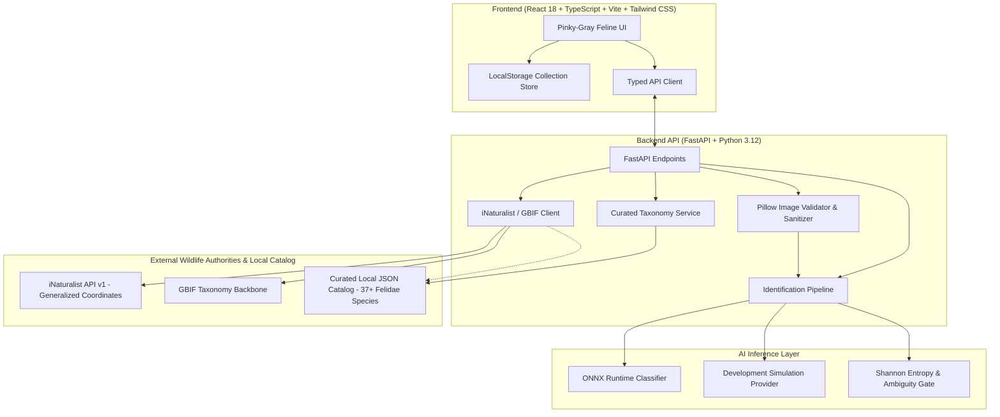

# FelidLens 🐾
### AI-Powered Feline Identification & Wildlife Discovery Platform

[-f472b6.svg)](https://github.com/Horrid-12/felidlens)
[](https://opensource.org/licenses/MIT)
[](https://fastapi.tiangolo.com/)
[](https://vitejs.dev/)
[-f472b6.svg)](https://www.iucnredlist.org/)

> [!IMPORTANT]
> **Alpha Release Notice:**
> FelidLens is currently in **Alpha** (v0.1.0-alpha). Features, neural inference models, and taxonomic mappings are in active development. AI classifications are probabilistic estimations based on morphological visual markers and should be independently verified.

> [!NOTE]
> **Original Concept & Attribution:**
> FelidLens was inspired by the original idea and architecture of **[BirdLens](https://github.com/sdprojects12/birdlens)** by [sdprojects12](https://github.com/sdprojects12). Reimagined and built from the ground up for the entire cat family (**Felidae**), FelidLens introduces a pinky-gray velvet feline aesthetic, responsible wildlife coordinate obscuration, Shannon entropy uncertainty gatekeeping, and a curated multi-lineage cat taxonomy.

---

**FelidLens** is an immersive wildlife discovery platform and AI field guide dedicated to the entire cat family (**Felidae**). Spanning all 41 recognized wild and domestic species across both subfamilies (*Pantherinae* and *Felinae*) and all 8 evolutionary lineages, the application pairs computer vision identification with transparent uncertainty indicators, ethical wildlife conservation protocols, and a gamified naturalist expedition journal.

---

## 🌟 Key Features

1. **AI Feline Paw Scanner**:
   - Drag-and-drop, file picker, and mobile camera capture.
   - Pillow-based MIME, file size (up to 15MB), format, and EXIF sanitization.
   - Cinematic scanning HUD with real-time diagnostic feline progress.
   - Ranked candidate predictions with percentage match and morphology rationales.
   - **Transparent Uncertainty**: Uses Shannon entropy to distinguish confident predictions from ambiguous sister taxa.
   - **Out-of-Domain Detection**: Explicitly identifies non-felid images (canines, landscapes, vehicles) without returning deceptive predictions.

2. **Comparative Morphology Analyzer**:
   - Side-by-side diagnostic comparisons between lookalike species (e.g. Jaguar vs. Leopard, Margay vs. Ocelot, Bobcat vs. Canada Lynx).

3. **Curated Felidae Species Atlas**:
   - 37+ extant wild and domestic feline species cataloged with peer-reviewed data based on Kitchener et al. (IUCN Cat Specialist Group).
   - Filterable by subfamily (*Pantherinae* / *Felinae*), ecology (wild vs. domestic), and IUCN Red List status (CR, EN, VU, NT, LC, Domesticated).
   - Detailed species profiles with morphometrics, size, weight, diet, behavior, range, habitats, and links to iNaturalist and GBIF.

4. **Expedition Journal & Gamification**:
   - LocalStorage persistent progress for anonymous users.
   - Discovery XP, ranks (*Kitten Scout* up to *Supreme Felid Sovereign*), and milestone badges (*Roar of the Ancients*, *Shadows of the North*, *Guardian of the Wild*).
   - Visual catalog tracking logged vs. undiscovered felid silhouettes with celebratory confetti.

5. **Responsible Wildlife Observations**:
   - Research-grade feline sightings integrated from the iNaturalist Network API.
   - **Strict Conservation Safety**: All coordinates are generalized to prevent the disturbance or illegal poaching of endangered wildlife.

6. **Provider-Independent Architecture**:
   - Abstract `BaseClassifier` interface supporting ONNX Runtime models, local vision networks, or remote inference APIs, with an honest, clearly marked development simulation provider for offline development.

---

## 🏗️ System Architecture



---

## 🚀 Quick Start Guide

### ⚡ One-Command Full-Stack Launch (Backend + Frontend)

Start both the FastAPI backend and Vite frontend concurrently with unified logging and graceful shutdown:

```bash
# Windows (PowerShell):
.\start.ps1

# Windows (Command Prompt / Double-Click):
start.bat

# Cross-Platform (Python):
python start.py
```

This launches:
- **Web App**: `http://localhost:5173`
- **Backend API**: `http://127.0.0.1:8000`
- **Interactive Swagger Docs**: `http://127.0.0.1:8000/docs`

Press `Ctrl+C` in the terminal to stop both services cleanly.

---

### Prerequisites
- **Node.js** >= v18.0.0
- **Python** >= 3.10 (Python 3.12 recommended; `uv` supported)

---

### 1. Backend Setup

```bash
# Navigate to backend directory
cd backend

# Create virtual environment (using uv or python venv)
uv venv --python 3.12 .venv
# On Windows:
.venv\Scripts\activate
# On Linux / macOS:
source .venv/bin/activate

# Install dependencies
uv pip install -r requirements.txt
# (or: pip install -r requirements.txt)

# (Optional) Configure environment variables
cp .env.example .env

# Run backend tests
python -m pytest tests/

# Start FastAPI development server
uvicorn app.main:app --host 127.0.0.1 --port 8000 --reload
```

The backend API will be available at:
- **API Root**: `http://127.0.0.1:8000`
- **Interactive Swagger Docs**: `http://127.0.0.1:8000/docs`
- **System Health**: `http://127.0.0.1:8000/api/health`

---

### 2. Frontend Setup

```bash
# In a new terminal window, navigate to the frontend directory
cd frontend

# Install npm dependencies
npm install

# Build for production verification
npm run build

# Start Vite development server
npm run dev
```

The frontend application will be running at:
- **Web App**: `http://localhost:5173`

Vite is preconfigured to reverse-proxy `/api` requests directly to `http://127.0.0.1:8000`.

---

## 📡 Backend API Endpoints

| Method | Endpoint | Description |
| :--- | :--- | :--- |
| `GET` | `/api/health` | Service health, model status, and indexed species count |
| `POST` | `/api/identify` | Multipart image upload for feline classification & uncertainty analysis |
| `GET` | `/api/species` | Search and filter Felidae species (by subfamily, IUCN, wild/domestic) |
| `GET` | `/api/species/featured/today` | Daily featured iconic felid species |
| `GET` | `/api/species/{slug}` | Comprehensive species profile, traits, diet, and similar taxa |
| `GET` | `/api/observations` | Public feline observations with obscured conservation coordinates |
| `GET` | `/api/collection/species` | Roster checklist, discovery badges, and rank tiers |

---

## 🧠 AI Identification & Uncertainty Handling

### Provider Interface
The identification service implements an abstract `BaseClassifier` protocol:
```python
class BaseClassifier(ABC):
    @abstractmethod
    async def predict(self, image: Image.Image) -> RawInferenceResult:
        pass
```

### Supported Providers:
1. **`OnnxClassifier`**: Runs an ONNX model with standard vision preprocessing (224x224, ImageNet normalization, softmax logits). Configured via `MODEL_PATH` in `.env`.
2. **`DevelopmentMockClassifier`**: When in development mode or when no model weights are loaded, provides consistent perceptual feature rankings clearly flagged with `is_mock: true`. Mock predictions are never presented as authentic AI output.

### Uncertainty Metric (Shannon Entropy):
$$H(P) = -\sum_{i=1}^{N} p_i \ln(p_i)$$
- **High Confidence**: Top score $\ge 60\%$ with low distribution entropy.
- **Moderate Confidence**: Top score between $35\%$ and $60\%$.
- **Uncertain State**: Top score $< 28\%$ or entropy $> 2.10$, indicating high ambiguity between sister taxa.
- **Non-Felid Detected**: Feature activation indicates out-of-domain imagery.

---

## 🛡️ Responsible Wildlife Data Protocol

FelidLens strictly adheres to biodiversity conservation ethics:
- **No Precise GPS Coordinates**: Observations retrieved from the iNaturalist API have their latitude and longitude generalized to broad regional boundaries.
- **Anti-Poaching Protection**: Vulnerable, endangered, and critically endangered species (such as *Panthera tigris*, *Panthera uncia*, *Leopardus jacobita*) are shielded from precise location harvesting.
- **Wildlife Viewing Ethics**: Prominent in-app advisories remind users that past sighting records do not imply present animal location, and wild animals should never be disturbed in their natural habitats.

---

## 🧪 Testing

### Backend Test Suite
Run all unit and integration tests covering image validation, identification status handling, taxonomy filters, and API contracts:
```bash
backend\.venv\Scripts\python.exe -m pytest backend/tests -v
```

### Frontend Build & Typecheck
```bash
npm run build --prefix frontend
```

---

## 📄 License & Attribution

- **Software**: MIT License
- **Original Inspiration**: [BirdLens](https://github.com/sdprojects12/birdlens) by [sdprojects12](https://github.com/sdprojects12)
- **Taxonomic Classification**: Kitchener et al. (2017) IUCN SSC Cat Specialist Group
- **Observational Data**: [iNaturalist Network](https://www.inaturalist.org) (CC BY-NC 4.0)
- **Taxonomic Backbone**: [GBIF](https://www.gbif.org)
- **Conservation Classifications**: [IUCN Red List](https://www.iucnredlist.org)
